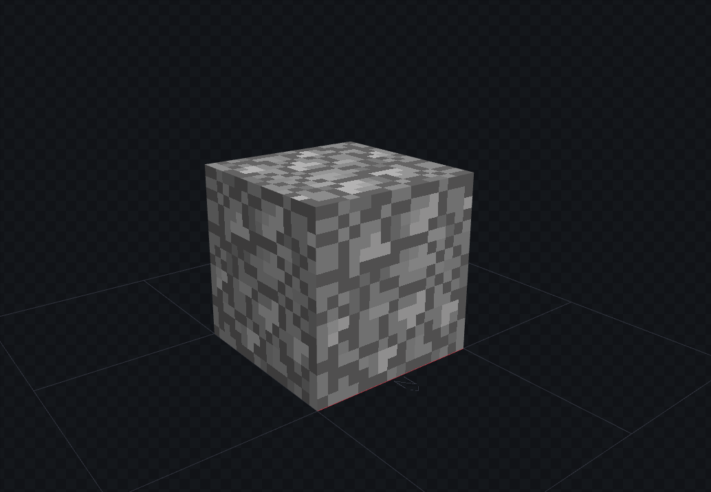
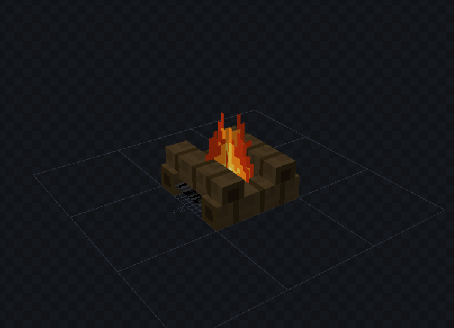
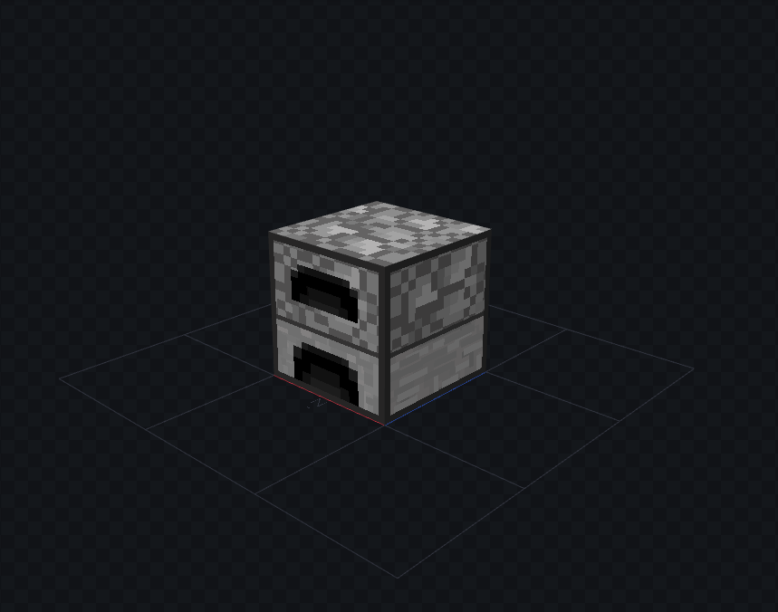
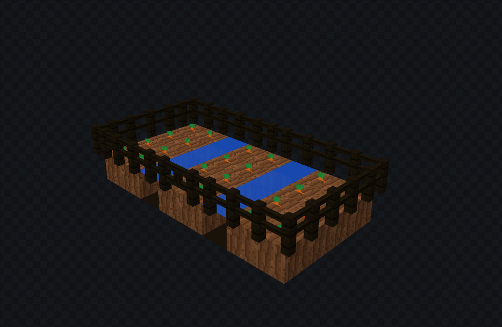
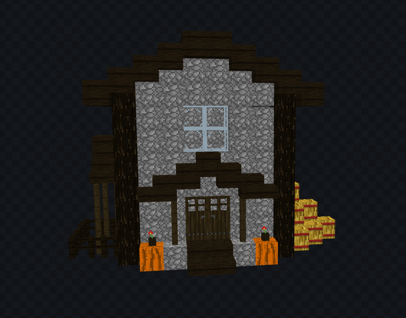
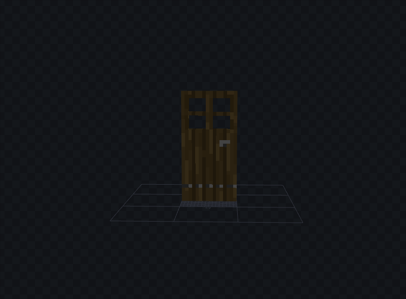

# prototipo-3D

## Sobre

Um pequeno jogo-protótipo 3D, com design inspirado no Minecraft. Criado como projeto básico de aprendizado sobre renderização 3D e movimentação de câmera. 

Para esse projeto, os modelos 3D foram criados no software gratuito **blockbench**, e renderizados na tela usando a biblioteca **raylib** e sua extensão **rcamera**. Para saber mais sobre os meios utilizados, veja a seção [Softwares e bibliotecas](#softwares-e-bibliotecas)


## Como rodar?

**Disclaimer: Esse código foi criado e testado em um ambiente Linux.**

Para facilitar a execução, vamos optar pelo uso do Makefile, certifique-se de ter instalado previamente as dependências necessárias (o projeto não rodará em caso de ausência de quaisquer delas):

- `gcc`
- `make`
- `raylib`

Com tudo certo, em um terminal, digite os seguintes comandos:

```bash 
# clone o repositório para ter acesso aos arquivos localmente
git clone https://github.com/luizagsoaress/prototipo-3D.git
cd prototipo-3D
# execute o programa
make install && make run
```

Pronto, agora com o protótipo rodando, confira os modelos 3D desenhados manualmente, com um design de blocos 16x16 inspirado em jogos como Minecraft. Os controles estão exibidos na tela do jogo, mas você também pode conferi-los abaixo: 

**Movimentação:** *W, A, S, D, Space, Left-Ctrl*

**Visão:** *setas do teclado ou mouse*

## Exemplos de modelos

<table>
  <tr>
    <td></td>
    <td></td>
    <td></td>
  </tr>
  <tr>
    <td></td>
    <td></td>
    <td></td>
  </tr>
</table>

## Softwares e bibliotecas


|Software/Biblioteca|Link para acesso                                                |
|----|----------------------------------------------------------|
|Blockbench| https://blockbench.net/| 
|Raylib| https://www.raylib.com/| 
|Rcamera (pertencente ao ecossistema da Raylib)| https://www.raylib.com/| 
